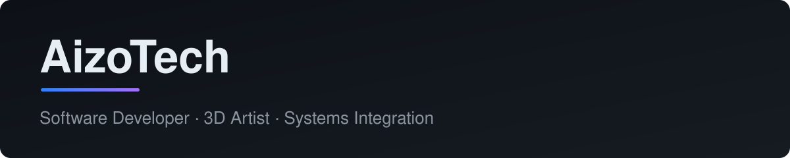

  

  
  
  
  
  

  
  
  
  

---

## About

I'm a software developer and 3D artist. I like building the point where hardware and software meet: things that run, connect, and last. Most of what I build lives in private repos, made for the people who needed it.

---

## What I build

- **Access and identity:** face recognition for doors and entry points, so access is automatic instead of manual
- **Connected buildings and sites:** gates, scales, and shop-floor equipment working together as one system
- **Chat and community tools:** Telegram bots and the services behind them
- **Quiet background software:** Windows services and tools that do their job without getting in the way
- **3D and real-time:** models and scenes in Blender, 3ds Max, Unity, and Unreal Engine

---

## Now building

### [Tessera](https://github.com/AizoTech-uz/Tessera)

A free, open source quad remesher for Blender, built from scratch in Python and C++. It turns dense, messy meshes into clean, mostly-quad topology with good edge flow.

   

The code will be published once the first working version is ready.

---

## Tech stack

| Area | Tools |
| --- | --- |
| Languages | C#, Python, C++ |
| Platforms | .NET, Windows Services, Telegram Bot API |
| Systems | Computer Vision, Systems Integration |
| 3D | Blender, 3ds Max, Unity, Unreal Engine |
